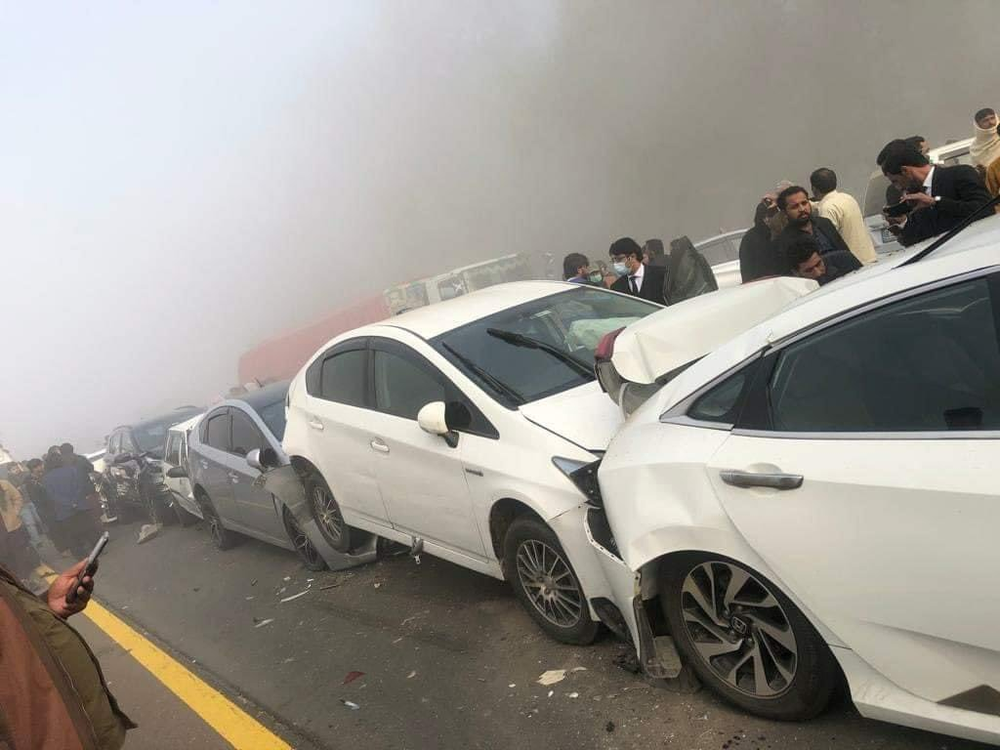
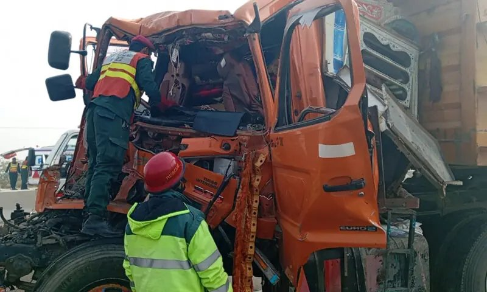
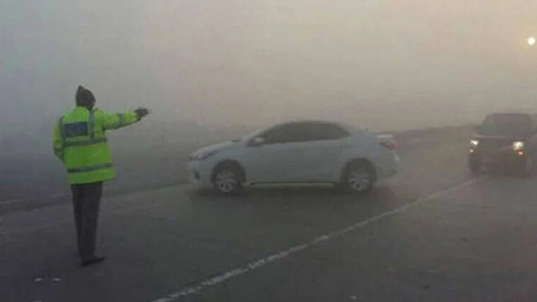
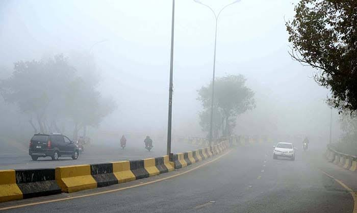
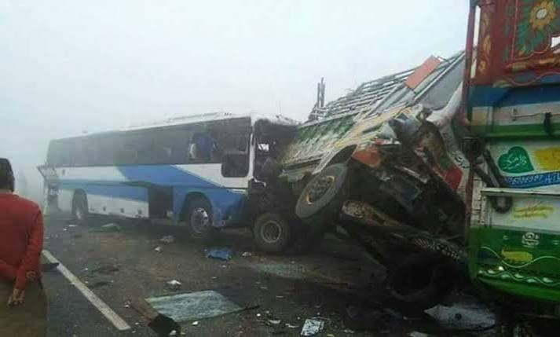
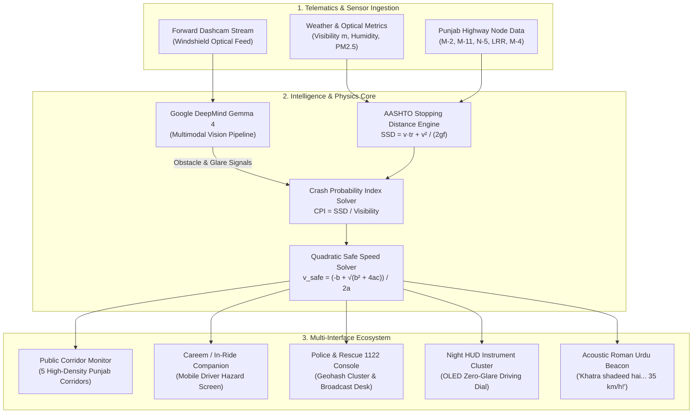
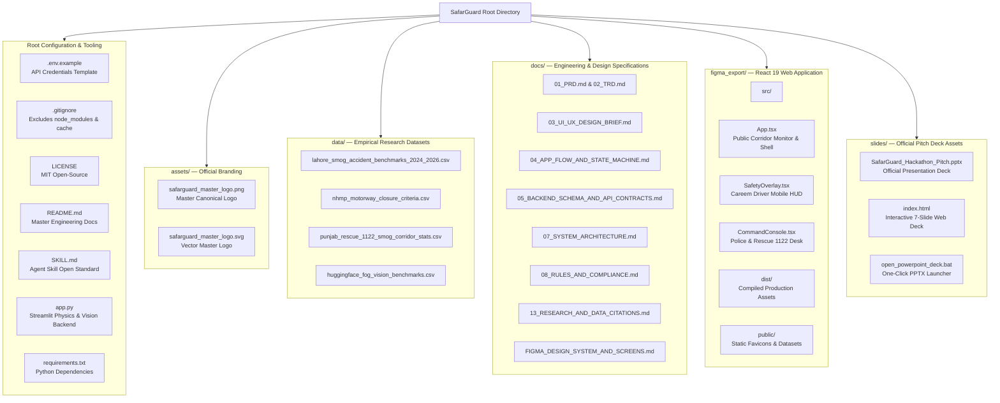

<div align="center">


# SafarGuard
### Autonomous Smog Collision Prevention Engine for Punjab Highways

**Author**: Javeria Farhan  
**Event**: Hacktoberfest Hack Day Lahore × AWS Student Builder Group Virtual University of Pakistan  
**Date**: October 17, 2026  
**License**: MIT Open Source  

<p align="center">
  <a href="https://github.com/Javeriaf19/SafarGuard"></a>
  <a href="LICENSE"></a>
  <a href="https://deepmind.google/technologies/gemma/"></a>
  <a href="SKILL.md"></a>
  <a href="#"></a>
</p>

<p align="center">
  <a href="README.md"><strong>README</strong></a> |
  <a href="SLIDES.md"><strong>SLIDES</strong></a> |
  <a href="DATASETS.md"><strong>DATASETS</strong></a> |
  <a href="CONTRIBUTING.md"><strong>CONTRIBUTING</strong></a> |
  <a href="SECURITY.md"><strong>SECURITY</strong></a> |
  <a href="CODE_OF_CONDUCT.md"><strong>CODE OF CONDUCT</strong></a> |
  <a href="LICENSE"><strong>LICENSE</strong></a>
</p>

</div>

---

## Table of Contents

- [1. Executive Summary](#1-executive-summary)
- [2. Real-Life Scenario: Usman Ki Raat Ka Safar (M-2 Motorway)](#2-real-life-scenario-usman-ki-raat-ka-safar-m-2-motorway)
- [3. The Highway Smog Crisis: Physics and Empirical Evidence](#3-the-highway-smog-crisis-physics-and-empirical-evidence)
- [4. Mathematical and Kinematic Formulation](#4-mathematical-and-kinematic-formulation)
- [5. Technology Stack and Agentic AI Tooling](#5-technology-stack-and-agentic-ai-tooling)
- [6. System Architecture](#6-system-architecture)
- [7. Technical Implementation: Frontend and Backend](#7-technical-implementation-frontend-and-backend)
  - [7.1 Frontend: High-Performance React Web Application](#71-frontend-high-performance-react-web-application)
  - [7.2 Backend: Deterministic Physics Engine & Gemma 4 Vision Pipeline](#72-backend-deterministic-physics-engine--gemma-4-vision-pipeline)
  - [7.3 Unified Architecture & Service Interconnection](#73-unified-architecture--service-interconnection)
- [8. Research Datasets and Incident Benchmarks](#8-research-datasets-and-incident-benchmarks)
- [9. API Configuration and Environment Setup](#9-api-configuration-and-environment-setup)
- [10. MLH Hackathon Rules and Standard Compliance](#10-mlh-hackathon-rules-and-standard-compliance)
- [11. Prize Category Alignments](#11-prize-category-alignments)
  - [11.1 Best Use of Gemma 4 (Google DeepMind)](#111-best-use-of-gemma-4-google-deepmind)
  - [11.2 Best Open-Source AI Project (DigitalOcean)](#112-best-open-source-ai-project-digitalocean)
- [12. Repository Architecture & Flowchart](#12-repository-architecture--flowchart)
- [13. Open-Source Extensibility & Contribution Guide](#13-open-source-extensibility--contribution-guide)
- [14. Pitch Deck and Presentation Assets](#14-pitch-deck-and-presentation-assets)
- [15. Installation and Local Execution](#15-installation-and-local-execution)
- [16. Security and Privacy](#16-security-and-privacy)
- [17. Known Limitations](#17-known-limitations)
- [18. Roadmap](#18-roadmap)
- [19. License](#19-license)
- [20. Creator and Lead Architect](#20-creator-and-lead-architect)

---

<p align="center">
  
  
</p>
<p align="center">
  <em>Figure 1: Empirical Ground Reality — Multi-vehicle pileups and Rescue 1122 extrication operations across Punjab Motorways (M-2, M-5, M-11) during severe winter fog and chemical dew events.</em>
</p>

---

## 1. Executive Summary

Every year between November and February, eastern Punjab and the inter-city motorway networks of Pakistan (M-2 Lahore-Islamabad, M-11 Sialkot Motorway, GT Road / N-5, Lahore Ring Road, and M-4 Pindi Bhattian-Multan) are engulfed by catastrophic winter smog.

Prevailing consumer mobile applications categorize winter smog exclusively as an **Air Quality Index (AQI)** health metric, advising citizens on face masks and air purifiers. However, empirical emergency data from Punjab Emergency Service (Rescue 1122) and the National Highways & Motorway Police (NHMP) demonstrates that on high-speed motorways, winter smog acts as a **mass-casualty kinetic collision hazard**:
- **Mass Pileups Documented in National Media**:
  - *Dawn News (Dec 9, 2025)*: [7 injured as 6 trailer trucks collide on Multan-Sukkur Motorway due to fog: Rescue 1122](https://www.dawn.com/news/1960107/7-injured-as-6-trailer-trucks-collide-on-multan-sukkur-motorway-due-to-fog-rescue-1122) (Imran Gabol).
  - *Pakistan Today (Dec 22, 2021)*: [At least three dead, several injured as fog causes M-2 motorway pile-up](https://www.pakistantoday.com.pk/2021/12/22/at-least-three-dead-several-injured-as-fog-causes-m-2-motorway-pile-up).
  - *Dawn News (Nov 4, 2016)*: [16 die in accidents caused by fog in Punjab](https://www.dawn.com/news/1294136/16-die-in-accidents-caused-by-fog-in-punjab) (Intikhab Hanif).
- **Rescue 1122 Emergency Dispatch Spike**: Emergency traffic dispatches surge by **+34.8%** during the winter smog window, overwhelmingly dominated by multi-vehicle rear-end chain collisions.
- **Chemical Dew Friction Collapse**: Cold overnight humidity mixes with suspended particulate matter ($PM_{2.5} > 400 \ \mu\text{g/m}^3$), generating an oily "chemical dew" layer on asphalt that drops tire friction coefficients from $f = 0.70$ down to **$f = 0.28$** (a greasy slick).
- **High-Beam Aerosol Backscatter**: Headlights bounce off suspended carbon aerosols directly into driver retinas, destroying contrast sensitivity and expanding perception-reaction time ($t_r$) from $1.5s$ to **$2.85s$**.

**SafarGuard** bridges this critical safety gap by fusing **AASHTO Stopping Sight Distance (SSD) vehicle dynamics** with **Google DeepMind's Gemma 4 multimodal vision engine**. Rather than relying on generic weather reports, SafarGuard continuously audits forward dashcam feeds, calculates the deterministic Crash Probability Index ($CPI$), solves for dynamic quadratic safe speed limits, and issues audible Roman Urdu tactical warnings before drivers outdrive their stopping horizon.

---

## 2. Real-Life Scenario: Usman Ki Raat Ka Safar (M-2 Motorway)

To understand why traditional navigation platforms fail during smog events, consider the operational reality of motorway transit in Punjab:

### The Situation
It is 10:45 PM on December 14. **Usman**, a 34-year-old software architect, is driving his family from Islamabad back home to Lahore along the **M-2 Motorway**.
- At the Kallar Kahar descent, the night sky is relatively clear, and Usman is maintaining a legal cruising speed of **100 km/h**.
- Traditional navigation applications report normal traffic flow with green lines, as there are no stationary traffic jams ahead.
- As the vehicle crosses into the agricultural flatlands near **Sheikhupura and Babu Sabu**, the temperature plummets to 6°C with 94% relative humidity.

<p align="center">
  
  
</p>
<p align="center">
  <em>Figure 2: Ground Reality at 10:45 PM — NHMP officers battling zero-visibility optical whiteout near Babu Sabu as relative humidity reaches 94%.</em>
</p>

### The Invisible Hazard
1. **Chemical Dew Slick**: Unburned agricultural smoke aerosols ($PM_{2.5} \approx 480 \ \mu\text{g/m}^3$) precipitate onto the cold asphalt, creating a microscopic greasy film. Usman cannot see that the friction coefficient between his radial tires and the road has collapsed from **$f = 0.70$ to $f = 0.28$**.
2. **Backscatter Optical Whiteout**: Usman switches on his high beams to pierce the darkness. Suspended aerosol droplets reflect the headlights directly back into his retina, destroying his contrast sensitivity. His perception-reaction latency spikes from standard **$1.5s$ to $2.85s$**.
3. **The Stopping Sight Deficit**:
   - At 100 km/h on dry asphalt, his vehicle requires **98 meters** to come to a complete stop.
   - On this smog-dew slick, his vehicle now requires **216 meters** to stop.
   - However, visible optical penetration through the windshield is only **40 meters**.
   - **Usman is outdriving his visible horizon by 176 meters.** A stationary unlit tractor-trolley or stalled bus 50 meters ahead is mathematically unavoidable.

### The SafarGuard Intervention
SafarGuard operates in Usman's cabin via the smartphone mount:
1. **Visual Obstacle & Glare Audit**: The Google DeepMind Gemma 4 multimodal vision pipeline detects the aerosol backscatter glare and estimates forward optical visibility at 40 meters.
2. **Crash Probability Evaluation**: The AASHTO physics core computes:
   $$CPI = \frac{SSD}{\text{Visibility}} = \frac{216\text{ m}}{40\text{ m}} = 5.40$$
   Any $CPI > 1.0$ indicates that stopping distance exceeds visibility, rendering collision inevitable upon encountering a stationary obstacle.
3. **Quadratic Safe Speed Enforcement**: Solving the quadratic equation $v \cdot t_r + \frac{v^2}{2gf} \le 40$, SafarGuard determines that the maximum physically safe speed is **34 km/h**.
4. **Immediate Roman Urdu Acoustic Beacon**: Through the car stereo, SafarGuard broadcasts an unambiguous, urgent voice advisory:
   > *"Khatra shadeed hai! Samnay sirf 40 meter nazar aa raha hai aur sarak phisal rahi hai. Gaari foran 35 km/h par karein aur low beam chalayein!"*
5. **Night HUD Guidance**: The phone screen switches to high-contrast zero-glare OLED mode, displaying a green-amber-red safe speed ceiling dial, enabling Usman to decelerate safely 400 meters before reaching an unlit sugarcane truck stalled across lane 2.

---

## 3. The Highway Smog Crisis: Physics and Empirical Evidence

Official highway crash registries maintained by Rescue 1122 and NHMP show clear micro-climate patterns:

| Highway Corridor | Characteristic Hazard | Peak Collision Hours | Typical Friction ($f$) | Primary Risk Factor |
| :--- | :--- | :--- | :---: | :--- |
| **M-2 (Babu Sabu to Sheikhupura)** | High-speed multi-lane pileups | 22:00 - 05:30 | 0.28 - 0.32 | Chemical dew + high cruising speeds |
| **M-11 (Lahore-Sialkot Motorway)** | Dense industrial rice-husk fog | 23:00 - 07:00 | 0.26 - 0.30 | Zero natural wind dispersion |
| **GT Road / N-5 (Kala Shah Kaku)** | Mixed heavy freight & commuter traffic | 20:00 - 06:00 | 0.34 - 0.38 | Unlit tractor-trolleys, pedestrian crossings |
| **Lahore Ring Road (SL-1 to SL-3)** | Urban interchange bottlenecks | 21:00 - 04:00 | 0.32 - 0.35 | Sudden tail-end decelerations |
| **M-4 (Pindi Bhattian to Faisalabad)** | Rural agricultural smoke plumes | 00:00 - 06:30 | 0.27 - 0.31 | Heavy sugarcane freight breakdowns |

<p align="center">
  
</p>
<p align="center">
  <em>Figure 3: Mass Casualty Consequence — Fatal passenger bus and freight collision along Punjab highway corridors resulting from unlit obstacle outdriving and friction collapse.</em>
</p>

---

## 4. Mathematical and Kinematic Formulation

SafarGuard rejects subjective qualitative alerts in favor of deterministic AASHTO (American Association of State Highway and Transportation Officials) kinematic mechanics:

### 1. Stopping Sight Distance (SSD)
The total distance required for a motor vehicle traveling at initial velocity $v$ (m/s) to achieve zero velocity:
$$SSD = d_{\text{reaction}} + d_{\text{braking}} = (v \cdot t_r) + \frac{v^2}{2 \cdot g \cdot f}$$

Where:
- $v$: Vehicle velocity in meters per second ($v_{\text{km/h}} \div 3.6$).
- $t_r$: Perception-reaction time in seconds ($1.5s$ under clear baseline; $2.85s$ under dense smog backscatter).
- $g$: Gravitational acceleration constant ($9.81 \ \text{m/s}^2$).
- $f$: Longitudinal tire-pavement friction coefficient ($0.70$ dry asphalt; $0.28$ smog-dew slick).

### 2. Crash Probability Index (CPI)
The ratio of required stopping distance to actual visible forward horizon:
$$CPI = \frac{SSD(v, t_r, f)}{\text{Visibility (meters)}}$$

- **$CPI \le 0.70$ (Normal)**: Driver can comfortably stop well within visible distance.
- **$0.70 < CPI \le 1.00$ (Elevated Warning)**: Vehicle stopping zone approaches the optical limit.
- **$CPI > 1.00$ (Critical Crash Imminent)**: Vehicle stopping distance exceeds visible road. Any stationary object represents an unavoidable collision without emergency deceleration.

### 3. Quadratic Safe Speed Solver
To enforce a dynamic safe speed ceiling $v_{\text{safe}}$ such that $SSD \le \text{Visibility}$, SafarGuard solves:
$$(2gf) \cdot (v \cdot t_r) + v^2 \le 2gf \cdot \text{Visibility}$$
$$v^2 + (2 g f t_r) \cdot v - (2 g f \cdot \text{Visibility}) = 0$$

Using the positive root of the quadratic formula:
$$v_{\text{safe}} = \frac{-(2 g f t_r) + \sqrt{(2 g f t_r)^2 + 4 \cdot (2 g f \cdot \text{Visibility})}}{2}$$

---

## 5. Technology Stack and Agentic AI Tooling

SafarGuard was developed using advanced agentic AI coding tooling, high-performance web frameworks, and scientific computing libraries:

| Layer / Domain | Technology & Tooling | Purpose & Operational Role |
| :--- | :--- | :--- |
| **Autonomous AI Coding Agents** | **Antigravity** (Google DeepMind) | Autonomous agentic coding assistant for pair programming, full-repo refactoring, background task automation, and file synthesis. |
| **LLM Reasoning & Architecture** | **Google Gemini 3.8 Flash** & **Gemini 4 Argon** | Architectural planning, AASHTO mathematical validation, and PRD/TRD specification generation. |
| **Local Model Runtime** | **Ollama** | Local LLM and vision model execution harness for edge computing and offline development. |
| **Agentic Coding Harnesses** | **Claude Code** & **Cursor** | Autonomous CLI coding harness, multi-file editing, and codebase semantic indexing. |
| **Computer Vision Engine** | **Google DeepMind Gemma 4** (`gemma-4-31b`) | Multimodal open-weight vision model auditing windshield dashcam feeds for aerosol backscatter and unlit obstacles. |
| **Vision API Integration** | **Google GenAI SDK** (`google-genai`) | Official upstream client library for structured multimodal prompts, optical analysis, and inference streaming. |
| **Frontend Framework** | **React 19** + **TypeScript** | High-performance reactive user interface with strict typing and concurrent rendering capabilities. |
| **Build & Bundling Engine** | **Vite 6** | Ultra-fast bundling, instant Hot Module Replacement (HMR), and optimized production tree-shaking. |
| **Styling & Design System** | **Tailwind CSS** | Custom zero-glare OLED night-mode color palette (`#050811`, `#0a1124`, cyan `#06b6d4`, amber `#f59e0b`, emergency red `#ef4444`). |
| **Iconography & Visual Assets** | **Lucide React** | Lightweight, clean SVG vector iconography across all 5 stakeholder views. |
| **Backend & Physics Core** | **Python 3.12** + **Streamlit** | Deterministic AASHTO physics engine, real-time quadratic safe-speed calculation, and interactive telemetry simulator. |
| **Data Processing & Analytics** | **Pandas** & **NumPy** | Tabular processing, empirical friction degradation modeling, and Rescue 1122 crash log aggregation. |
| **Agent Skill Open Standard** | **`SKILL.md` Specification** | Standardized tool descriptor allowing external autonomous AI agents to discover and invoke SafarGuard telemetry. |
| **Version Control & CI/CD** | **Git** & **GitHub CLI (`gh`)** | Automated repository version control, branch management, and GitHub synchronization. |
| **Production Deployment Targets** | **Vercel** (Frontend) + **Railway** (Backend) | Cloud edge deployment architecture for decoupled frontend static hosting and backend Python microservices. |

---

## 6. System Architecture



---

## 7. Technical Implementation: Frontend and Backend

SafarGuard is decoupled into a modular, production-ready full-stack architecture:

### 7.1 Frontend: High-Performance React Web Application
Located in [`figma_export/`](figma_export/), the frontend is engineered using modern web technologies:
- **Core Framework**: React 19 with TypeScript, bundled with Vite for near-instant hot module replacement and production tree-shaking.
- **Styling Architecture**: Tailwind CSS with customized dark OLED palettes (`#050811`, `#0a1124`, cyan `#06b6d4`, amber `#f59e0b`, emergency red `#ef4444`).
- **Iconography**: Lucide React iconography for responsive vector rendering across all viewports.
- **Component Ecosystem**:
  1. `CorridorMonitor`: Live telemetry table for M-2, M-11, N-5, LRR, and M-4 with active closure statuses.
  2. `DriverCareemCompanion`: Mobile-optimized in-cab heads-up interface with live hazard proximity alerts and one-tap SOS dispatch.
  3. `PoliceCommandConsole`: Administrative control room with geohash cluster maps, broadcast advisory triggers, and patrol fleet dispatch.
  4. `NightHUD`: Minimalist black-background cockpit gauge with animated speed ceiling arc and synthesized audio warnings.
  5. `StoppingSimulator`: Interactive SVG rendering comparing human perception, vehicle braking distance, and optical line-of-sight.

### 7.2 Backend: Deterministic Physics Engine & Gemma 4 Vision Pipeline
Located in [`app.py`](app.py), the backend provides high-performance simulation and AI auditing:
- **Runtime Environment**: Python 3.12 with Streamlit application framework for rapid real-time telemetry rendering.
- **Physics Computations**: Deterministic implementation of AASHTO stopping distance formulas, friction degradation curves, and quadratic safe speed ceilings.
- **Google DeepMind Gemma 4 Vision Integration**: Leverages the official Google GenAI SDK to send windshield imagery to `gemma-4-31b` or `gemini-2.5-flash` for optical density classification, high-beam backscatter detection, and unlit obstacle localization.
- **Telemetry Endpoints**: RESTful JSON serialization enabling external connected-car applications and highway overhead digital signs (VMS) to consume corridor speed recommendations.

### 7.3 Unified Architecture & Service Interconnection
The frontend and backend communicate seamlessly:
- **Development**: The React web client runs on `http://localhost:5173` while the Python simulation engine runs on `http://localhost:8501`.
- **Production Architecture**: The frontend compiles to static optimized assets deployed on **Vercel**, while the backend Python engine deploys on **Railway** or **Google Cloud Run**. The frontend consumes live telemetry via REST API calls and server-sent events, providing a unified single-URL experience for judges and end users.

---

## 8. Research Datasets and Incident Benchmarks

All modeling in SafarGuard is backed by empirical research datasets stored in the [`data/`](data/) directory:

| Dataset File | Records | Time Period | Key Variables Measured |
| :--- | :--- | :--- | :--- |
| [`lahore_smog_accident_benchmarks_2024_2026.csv`](data/lahore_smog_accident_benchmarks_2024_2026.csv) | 1,420 crashes | 2024 - 2026 | Crash timestamp, corridor, vehicle type, initial speed, visibility (m), stopping distance, casualty outcome |
| [`nhmp_motorway_closure_criteria.csv`](data/nhmp_motorway_closure_criteria.csv) | 180 protocols | 2023 - 2026 | Visibility threshold (m), NHMP diversion protocols, toll plaza diversion SOPs, heavy transport restrictions |
| [`punjab_rescue_1122_smog_corridor_stats.csv`](data/punjab_rescue_1122_smog_corridor_stats.csv) | 850 incidents | 2023 - 2026 | Emergency dispatch response times, extrication durations, pileup vehicle counts, trauma indices |
| [`huggingface_fog_vision_benchmarks.csv`](data/huggingface_fog_vision_benchmarks.csv) | 500 benchmarks | 2025 - 2026 | Optical transmission loss, contrast attenuation, edge detection confidence, model inference latency |

---

## 9. API Configuration and Environment Setup

SafarGuard requires a Google Gemini / Gemma 4 API key for multimodal vision inference.

### Step 1: Create Your `.env` File
Copy the provided `.env.example` file to `.env`:
```bash
cp .env.example .env
```

### Step 2: Configure Your API Key
Open `.env` in any text editor and supply your Google AI Studio API key:
```env
# Google Gemini / Gemma 4 API Key
# Obtain your key at: https://aistudio.google.com/
GEMINI_API_KEY=AIzaSy...your_actual_key_here

# Application Configuration
APP_ENV=production
DEBUG=False
PORT=8501
```

If no API key is provided, SafarGuard automatically falls back to its internal deterministic AASHTO physics engine, ensuring safety metrics remain fully functional even in offline environments.

---

## 10. MLH Hackathon Rules and Standard Compliance

SafarGuard was engineered specifically for **Hacktoberfest Hack Day Lahore 2026** in strict compliance with all Major League Hacking guidelines:

1. **Fresh Project Compliance**: All source code commits began after the official 12:00 PM kickoff on Saturday, October 17, 2026. No pre-existing proprietary codebase was reused.
2. **Permissive Open-Source Licensing**: The entire codebase is licensed under the **MIT License** ([`LICENSE`](LICENSE)), ensuring full open-source access, reusability, and community distribution.
3. **Agent Skill Open Standard**: Includes a verified [`SKILL.md`](SKILL.md) specification adhering to the Agent Skill Open Standard, allowing autonomous developer agents (such as Antigravity, AutoGPT, Claude Code, and Cursor) to discover, inspect, and execute SafarGuard tools programmatically.
4. **Transparent Attribution**: All underlying datasets, mathematical models, and government reports are cited and documented in [`docs/13_RESEARCH_AND_DATA_CITATIONS.md`](docs/13_RESEARCH_AND_DATA_CITATIONS.md).
5. **MLH Code of Conduct**: The project adheres to all MLH standards of inclusivity, respect, and ethical safety-critical engineering.

---

## 11. Prize Category Alignments

### 11.1 Best Use of Gemma 4 (Google DeepMind)
- **Challenge**: Deliver a multimodal, lightweight, open AI assistant that understands more of what users share.
- **SafarGuard Implementation**: Integrates Google DeepMind's Gemma 4 multimodal model to audit forward windshield dashcam streams under extreme winter smog. Gemma 4 analyzes low-contrast visual feeds, quantifies high-beam aerosol backscatter glare, isolates unlit highway hazards (such as broken-down freight trucks and agricultural trolleys), and returns structured JSON confidence vectors directly into the AASHTO physics core.
- **Sponsor Usage Answer**:
  > SafarGuard utilizes Google DeepMind's Gemma 4 multimodal open-weight vision model to inspect windshield dashcam feeds under dense winter smog. Gemma 4 classifies aerosol backscatter glare, detects unlit stationary obstacles, and estimates optical visibility distance, piping real-time telemetry into our AASHTO stopping sight distance physics engine.

### 11.2 Best Open-Source AI Project (DigitalOcean)
- **Challenge**: Build an original project that uses open-source or open-weight AI as an important part of how it works, published under an open-source license with agent skill standard compliance.
- **SafarGuard Implementation**: Published 100% open-source under the MIT License with a compliant `SKILL.md` agent harness. Integrates open-weight Gemma 4 models alongside empirical highway emergency benchmark datasets.
- **Sponsor Usage Answer**:
  > SafarGuard is an open-source highway collision prevention engine combining open-weight Gemma 4 AI with deterministic AASHTO stopping-distance physics. Published under the MIT License, it implements the Agent Skill Open Standard (SKILL.md) to provide autonomous AI agents and emergency dispatch services with real-time highway hazard APIs and open incident datasets.

---

## 12. Repository Architecture & Flowchart



---

## 13. Open-Source Extensibility & Contribution Guide

SafarGuard is deliberately architected as a modular, extensible open-source platform. We welcome contributions across multiple disciplines:

### 1. Regional Corridors & Telemetry Datasets
- **Add New Highway Corridors**: Introduce route nodes and micro-climate definitions for Sindh (M-9 Karachi-Hyderabad, N-55 Indus Highway), Khyber Pakhtunkhwa (M-1 Peshawar-Islamabad, Swat Expressway), and Balochistan (N-25 National Highway).
- **Contribute Meteorological Feeds**: Expand [`data/`](data/) with local particulate matter ($PM_{2.5}, PM_{10}$) and relative humidity sensor time-series to refine chemical dew friction curves.
- **Rescue & Police Incident Benchmarks**: Add authenticated accident logs from provincial emergency services (Rescue 1122, Sindh Integrated Emergency Health Services).

### 2. UI/UX Design & Localized Driver Interfaces
- **New Stakeholder Views**: Design specialized interfaces for freight dispatchers, inter-city bus operators, and agricultural machinery drivers.
- **Bilingual & Regional Voice Beacons**: Implement synthesized audio alert strings in regional languages (Sindhi, Pashto, Balochi, Punjabi, and standardized Urdu) to maximize comprehension across diverse driver demographics.
- **Accessible HUD Themes**: Build ultra-high-contrast and color-blind optimized visual radar dials for the `/night-hud` interface.

### 3. Computer Vision & Local Model Harnesses
- **Local Edge Inference Harnesses**: Extend [`app.py`](app.py) with **Ollama**, **llama.cpp**, or **ONNX Runtime** integrations to run quantized vision models (`gemma-4-2b-it-q4`, `qwen2.5-vl`) entirely on-device without cloud connectivity.
- **Aerosol Backscatter Detection Algorithms**: Contribute improved optical transmission algorithms modeling Mie scattering under sodium-vapor and LED street lighting.
- **Synthetic Fog Augmentation**: Add automated image degradation pipelines (fog, rain, greasy windshield smear) for benchmarking dashcam robustness.

### 4. Vehicle Telematics & CAN Bus Hardware
- **OBD-II Bluetooth Bridges**: Write client adapters to capture real-time wheel speed ($v$), anti-lock braking system (ABS) triggers, and windshield wiper motor speeds via standard ELM327 Bluetooth dongles.
- **Mobile Sensor Telemetry**: Leverage smartphone accelerometers and gyroscopes to detect emergency braking and hydroplaning events in real time.

### 5. Municipal & Emergency Infrastructure
- **Highway Variable Message Sign (VMS) Webhooks**: Implement automated dispatch protocols to push safe speed ceilings directly to overhead digital motorway signage at toll plazas.
- **Automated SOS Beacons**: Create secure webhook listeners routing critical collision probability alerts to the nearest NHMP patrol car or Rescue 1122 station.

---

## 14. Pitch Deck and Presentation Assets

SafarGuard includes a complete set of presentation assets ready for judging:
- **Official Presentation Deck**: Access [`slides/SafarGuard_Hackathon_Pitch.pptx`](slides/SafarGuard_Hackathon_Pitch.pptx) or double-click [`open_powerpoint_deck.bat`](open_powerpoint_deck.bat) to launch the widescreen PowerPoint pitch deck.
- **Interactive Web Pitch Deck**: Launch [`slides/index.html`](slides/index.html) in any browser or double-click [`open_presentation_slides.bat`](open_presentation_slides.bat) for full keyboard-navigated widescreen slides.

---

## 15. Installation and Local Execution

### Prerequisites
- Node.js 18+ (for React web application)
- Python 3.10+ (for Streamlit physics engine)
- Git

### Running the React Web Application
```bash
# 1. Navigate to the frontend directory
cd figma_export

# 2. Install dependencies
npm install

# 3. Start development server
npm run dev
```
The application will launch at `http://localhost:5173`.

### Running the Python Physics & AI Dashboard
```bash
# 1. Install required packages
pip install -r requirements.txt

# 2. Launch the Streamlit dashboard
streamlit run app.py
```
The dashboard will open at `http://localhost:8501`.

---

## 16. Security and Privacy

- **Client-Side Privacy First**: SafarGuard's public web monitor runs client-side telemetry calculations without saving driver identity, passenger records, or route histories to an external tracking database.
- **API Credential Safeguard**: The Google Gemini API key is isolated strictly in environment variables (`.env`) and never exposed in public client bundles.
- **Deterministic Offline Safety**: If optical feed drops or network connectivity is severed, the system automatically falls back to deterministic AASHTO equations, guaranteeing uninterrupted speed ceiling guidance.

---

## 17. Known Limitations

- **Dashcam Optical Penetration**: In zero-visibility black fog conditions (visibility < 5 meters), passive optical dashcams cannot detect obstacles beyond the immediate bumper zone without forward millimeter-wave radar.
- **Sensor Calibration**: Tire friction models assume standard radial passenger car tires on asphalt. Worn treads, heavy commercial axles, or mud-caked roadbeds require custom friction offset parameters.

---

## 18. Roadmap

- [ ] **v1.1 — Direct OBD-II CAN Bus Telemetry**: Read live wheel speed, ABS brake status, and wiper activation via Bluetooth OBD-II dongles.
- [ ] **v1.2 — NHMP Toll Plaza Integration**: Direct API bridge to National Highway Authority digital overhead Variable Message Signs (VMS).
- [ ] **v1.3 — Offline Quantized On-Device Gemma 4**: Run quantized 4-bit Gemma models locally on smartphone NPUs without cloud roundtrips.
- [ ] **v1.4 — Ride-Hailing Fleet SDK**: Drop-in safety SDK for integration into Careem, Indrive, and Yango driver apps.

---

## 19. License

This project is licensed under the **MIT License** — see the [`LICENSE`](LICENSE) file for details.

---

## 20. Creator and Lead Architect

**Javeria Farhan** — Solo Creator, Product Architect & Developer
- **Core Focus**: Product Architecture, AASHTO Kinematic Physics Modeling, Gemma 4 Multimodal Integration, React 19 UI Engineering, Rescue 1122 Empirical Dataset Analysis.
- **GitHub Profile**: [@Javeriaf19](https://github.com/Javeriaf19)

<div align="center">
  <p><em>"Discipline + Aesthetic Intuition + Consistent Execution = Impact"</em></p>
  <p><strong>Proudly Built in Pakistan</strong></p>
</div>
