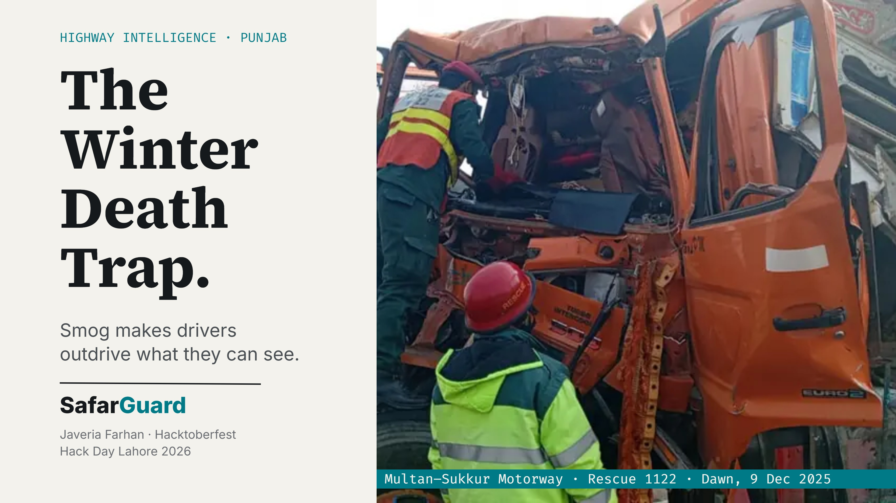
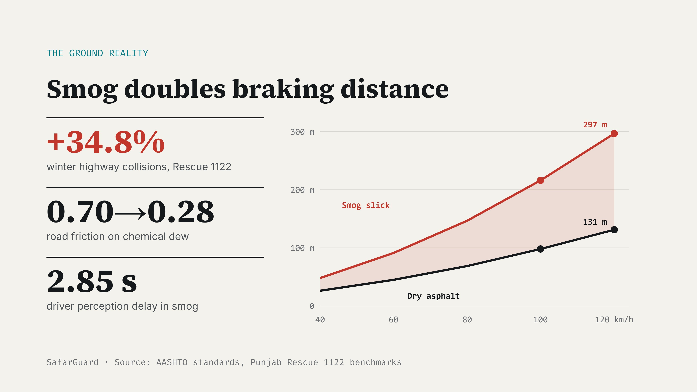
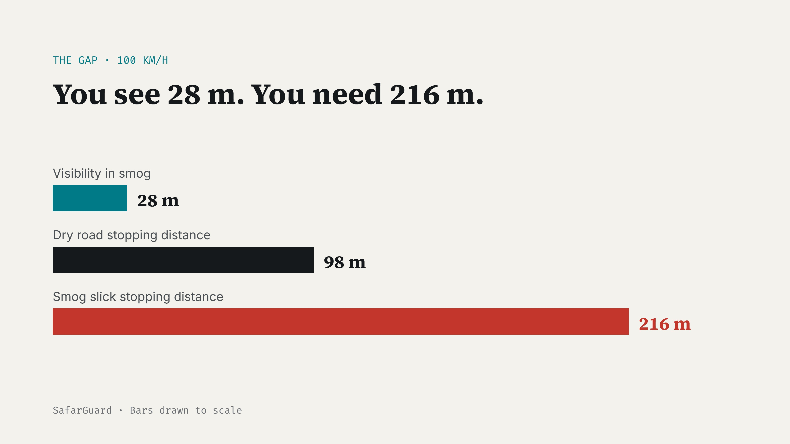
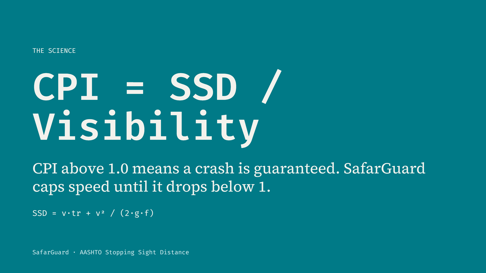
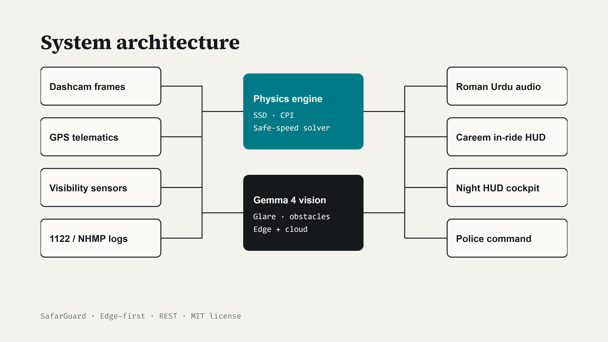
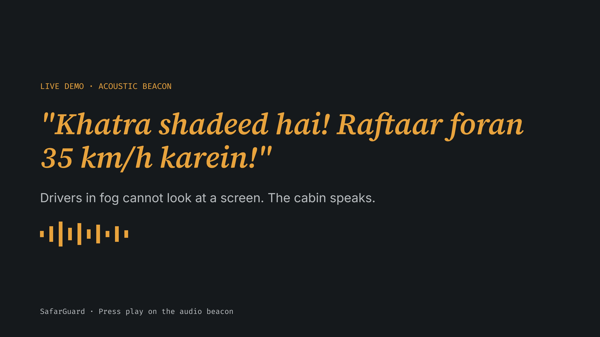
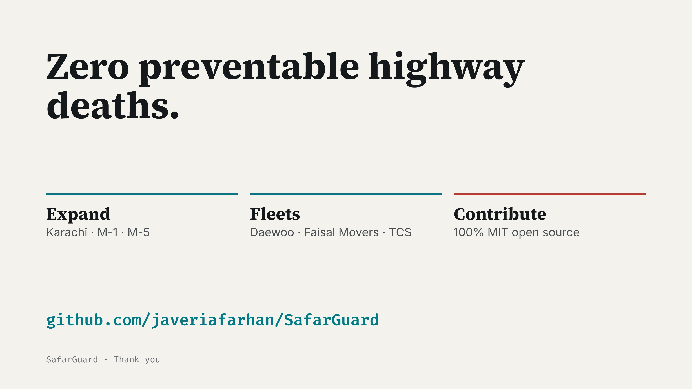

# Official Hackathon Pitch Deck & Presentation Guide

SafarGuard includes a complete set of presentation assets ready for judging and evaluation at **Hacktoberfest Hack Day Lahore 2026**.

---

## Direct In-Browser Presentation Access

GitHub cannot preview `.pptx` PowerPoint files directly in the browser. To solve this, SafarGuard provides direct **in-browser PDF previewing**, an **interactive web presentation**, and high-resolution slide panels:

| Format | Access Link | Best For |
| :--- | :--- | :--- |
| **In-Browser PDF Deck** | [`slides/SafarGuard_Pitch_Deck.pdf`](slides/SafarGuard_Pitch_Deck.pdf) | Immediate 1-click full-screen review on GitHub with zero downloads. |
| **Interactive Web Deck** | [`slides/index.html`](slides/index.html) | Keyboard-navigated widescreen presentation matching the dark OLED theme. |
| **PowerPoint Deck (.pptx)** | [`slides/SafarGuard_Hackathon_Pitch.pptx`](slides/SafarGuard_Hackathon_Pitch.pptx) | Local Microsoft PowerPoint presentation. |
| **Windows One-Click Launcher** | [`open_powerpoint_deck.bat`](open_powerpoint_deck.bat) | Instant launch on Windows machines. |

---

## Slide Deck Gallery (7 Slides)

    
    
    
    
    
    
  

---

## Slide Outline & Key Takeaways

1. **Slide 1 — Don't Outdrive What You Can See**: Introducing SafarGuard as the Autonomous Smog Collision Prevention Engine for Punjab Highways.
2. **Slide 2 — The Ground Reality Crisis**: Rescue 1122 dispatches surge +34.8% in winter; multi-vehicle pileups on M-2, M-11, and N-5.
3. **Slide 3 — The Two Invisible Killers**: Chemical dew asphalt slick ($f = 0.70 \to 0.28$) and high-beam aerosol backscatter ($t_r = 1.5s \to 2.85s$). Stopping distance blows out from 98m to 216m while sight drops to 40m.
4. **Slide 4 — The SafarGuard Innovation**: Fusing AASHTO kinematic physics with Google DeepMind Gemma 4 multimodal dashcam vision.
5. **Slide 5 — 5 Multi-Stakeholder Views**: Public Corridor Monitor, Driver Careem Companion, Police & Rescue 1122 Console, Night HUD Cockpit, and Stopping Simulator.
6. **Slide 6 — Dual Prize Alignment**:
   - Google DeepMind: Best Use of Gemma 4 (multimodal dashcam vision).
   - DigitalOcean: Best Open-Source AI Project (100% MIT, SKILL.md Agent Standard, 4 empirical datasets).
7. **Slide 7 — Scale & Life-Saving Impact**: Protecting 1,200+ kilometers of Pakistan's high-speed transit corridors.
