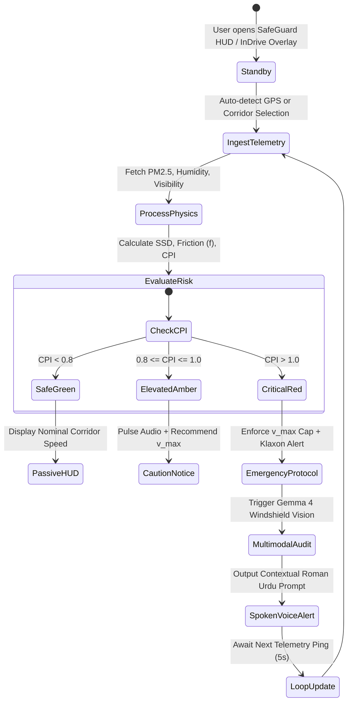

# Application Flow & State Machine Specification
## SafeGuard: Real-Time Event Driven Safety Lifecycle

- **Author**: Javeria Farhan
- **Date**: October 17, 2026
- **Version**: 1.0.0

---

## 1. End-to-End User & Driver Journey

---

## 2. Finite State Machine (FSM) Definition

| State ID | State Name | Entry Condition | System Behaviors | Transition Trigger |
| :--- | :--- | :--- | :--- | :--- |
| **S0** | `BOOT_STANDBY` | Application load / App init | Load static benchmarks, verify API keys / Ollama | Corridor selected or GPS lock $\to$ `S1` |
| **S1** | `TELEMETRY_SYNC` | Corridor selected or timer fired | Query Open-Meteo REST API (cache TTL: 300s) | Ingestion completed $\to$ `S2`; API failure $\to$ `S1_FALLBACK` |
| **S1_FALLBACK** | `OFFLINE_SIM` | Network timeout / Motorway dead zone | Load regional November median datasets | Dataset loaded $\to$ `S2` |
| **S2** | `PHYSICS_SOLVE` | Fresh telemetry received | Run SSD formula, adjust $t_r$ and $f$, derive CPI | Math calculated $\to$ `S3` |
| **S3_SAFE** | `NOMINAL_CRUISE` | $CPI \le 0.80$ | Green UI, silent background monitoring | Next loop $\to$ `S1` |
| **S3_WARN** | `CAUTION_BUFFER` | $0.80 < CPI \le 1.00$ | Amber UI, advisory chime, display $v_{max}$ | Speed escalated or visibility dropped $\to$ `S3_DANGER` |
| **S3_DANGER** | `CRITICAL_INTERVENE` | $CPI > 1.00$ | Red flashing HUD, klaxon alert, mandatory deceleration | Gemma 4 vision triggered $\to$ `S4` |
| **S4** | `MULTIMODAL_AUDIT` | Frame captured / Preset selected | Send image to Gemma 4 (glare & unlit hazard detect) | JSON response parsed $\to$ `S5` |
| **S5** | `ACOUSTIC_DISPATCH` | Vision + Physics risk verified | Speak Roman Urdu safety guidance via browser/audio | Speech ended $\to$ `S1` |

---

## 3. Incident Escalation & Highway Diversion Loop

When $CPI > 1.20$ across a continuous 5-kilometer corridor:
1. **Direct Driver Alert**: System issues diversion notice:
   *"M-2 closure alert: Zero visibility ahead. Exit at next interchange or pull over at Sukheki Service Area immediately."*
2. **Crowdsourced Hazard Broadcast**: If accelerometer registers sudden braking (> $4.5 \text{ m/s}^2$) or swerve, a 500m geofence is pinned on the cloud map server to warn trailing drivers.
3. **Enterprise Dispatch Sync**: If connected to fleet management (e.g., Daewoo or TCS), an automated safety telemetry event (`hazard_severity: 3`) is dispatched to fleet headquarters.
