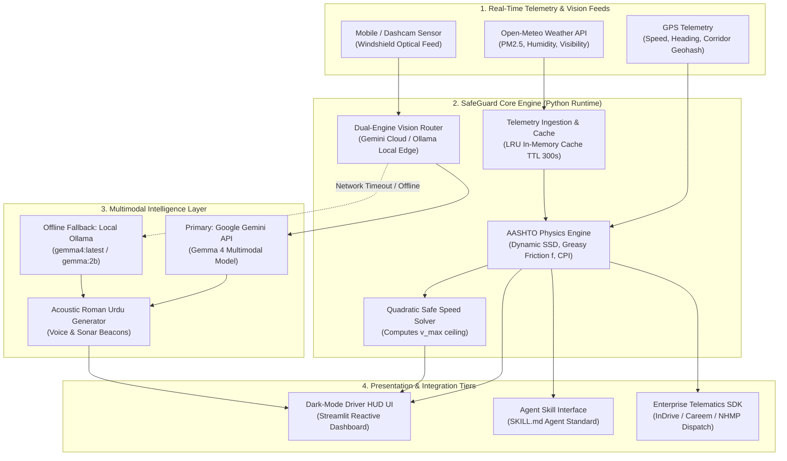

# System Architecture & Technical Topology
## SafeGuard: Autonomous Smog Accident Prevention Platform

- **Author**: Javeria Farhan
- **Date**: October 17, 2026
- **Version**: 1.0.0
- **Classification**: Open-Source Distributed Telematics Architecture

---

## 1. High-Level System Architecture Diagram

---

## 2. Architectural Subsystems

### 2.1 Subsystem A: Telemetry & Ingestion Pipeline
- **Input Channels**: REST calls to Open-Meteo Air Quality and Weather APIs.
- **Fail-Safe Mechanism**: If network is unavailable on remote stretches of M-2 Motorway (e.g., Salt Range / Sukheki corridor), the engine switches to the local embedded historical dataset (`lahore_smog_accident_benchmarks_2024_2026.csv`).

### 2.2 Subsystem B: Deterministic Safety Physics Engine
- Operates independently of AI hallucination risks. 
- All safety margins, braking distances ($SSD$), and maximum velocities ($v_{max}$) are derived via rigorous mechanical engineering equations.
- Takes dynamic account of the **chemical dew slick**:
  $$\text{If } RH > 80\% \land PM_{2.5} > 250 \implies f \to 0.28, \ t_r \to 2.85s$$

### 2.3 Subsystem C: Dual-Mode Multimodal AI (Gemma 4 + Ollama)
- **Why Dual-Mode?**
  1. *Online Mode (Google Gemini API)*: Provides zero-install cloud execution of Gemma 4 with rich multimodal reasoning.
  2. *Edge Mode (Ollama)*: Meets the DigitalOcean & MLH partner challenge requirement for local edge inference on devices without persistent 4G connections.
- **Vision Tasks**:
  - Optical density & fog extinction mapping.
  - Identification of glare backscatter caused by high beams.
  - Spatial detection of unlit objects (bullock carts, sugarcane tractor-trolleys, broken-down vehicles).

### 2.4 Subsystem D: Integration & Agent Standard (`SKILL.md`)
- The system exposes an Agent Skill Open Standard interface (`SKILL.md`) in the repository root.
- This allows external AI orchestrators (e.g., Antigravity, Claude, AutoGPT, Hermes Agent) to call SafeGuard as a deterministic tool for route risk evaluation.

---

## 3. Security & Resilience Principles

1. **Zero Personally Identifiable Information (Zero-PII)**: GPS coordinates are snapped to regional corridor geohashes; no individual license plate or phone identity is stored.
2. **Sub-second Circuit Breaker**: If the multimodal vision API does not respond within 1800ms, the physics warning is dispatched immediately without waiting for vision analysis.
3. **Open-Source MIT Architecture**: Free from proprietary closed vendor locks. Permissive for commercial ride-hailing and emergency transport integration.
